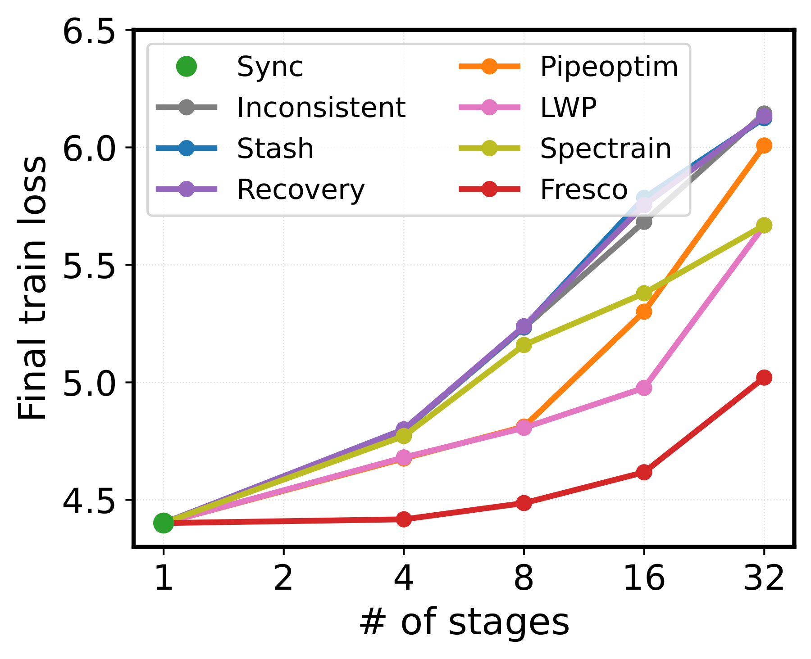
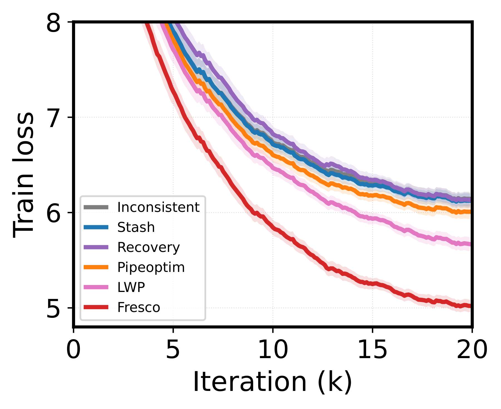
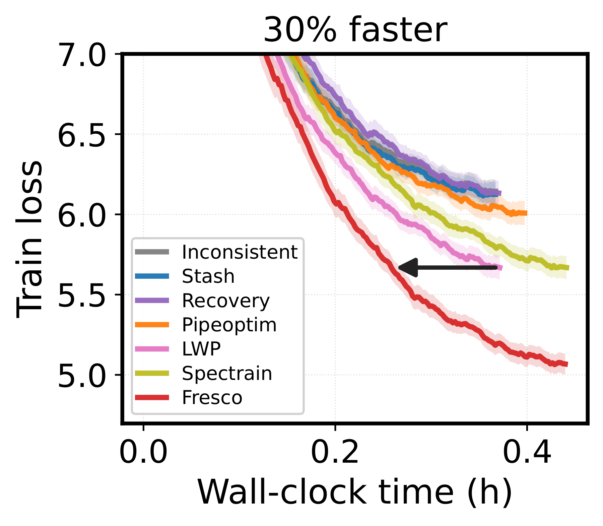
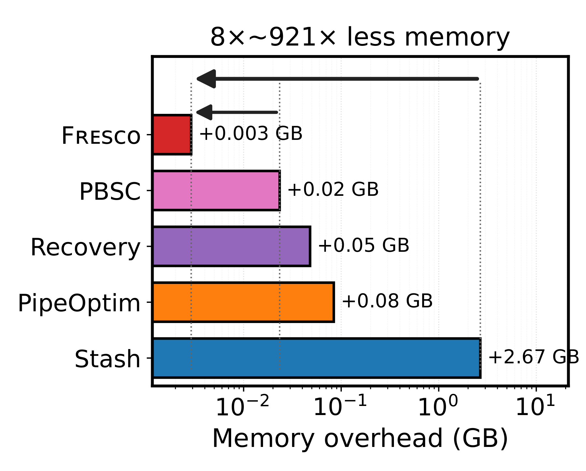

# FRESCO: A Novel Consistency Control for Asynchronous Pipeline Parallel Training

This repository contains the official PyTorch implementations and source code for reproducing key results of the NeurIPS 2026 paper:

> **FRESCO: A Novel Consistency Control for Asynchronous Pipeline Parallel Training** \
> [Dongyeop Lee](https://dongyeoplee2.github.io/)**¹** and [Namhoon Lee](https://namhoonlee.github.io/)**¹** \
> **¹** Pohang University of Science and Technology (POSTECH) \
> Paper: <https://arxiv.org/abs/2611.11238>

contact: [dongyeop.lee2@postech.ac.kr](mailto:dongyeop.lee2@postech.ac.kr)

## Overview

FRESCO is an asynchronous pipeline parallel training algorithm that adjusts each optimizer step to reduce its adverse effects on concurrent gradient computations. This distinguishes it from the prevailing approach of constructing “consistent” gradients, which may still be unusable at current parameters that have strayed arbitrarily far. The key idea is *forward equivalence*: parameter movement that preserves the forward behavior observed by each microbatch maintains gradient consistency and relevance to the current parameters without freezing the exact parameter values. FRESCO finds the minimal modification to each update that satisfies this condition by tracking a compact spectral basis of in-flight activations instead of full parameter copies.

| **Robustness across pipeline depths** | **Training progress (P=32)** | **Wall-clock efficiency (P=32)** | **Memory overhead (P=32)** |
| :---: | :---: | :---: | :---: |
| [](docs/fig/figure_4a.png) | [](docs/fig/figure_4b.png) | [](docs/fig/figure_5a.png) | [](docs/fig/figure_5b.png) |

## How FRESCO Works

FRESCO implements the forward-equivalence principle into a per-step layerwise constrained optimization problem that enforces forward equivalence to a desired degree:

$$
\min_{\Delta'} \frac{1}{2}\lVert\Delta'-\Delta\rVert_F^2
\quad\text{subject to}\quad
(W+\Delta')\bar{X}_k=W\bar{X}_k.
$$

- $\Delta$: the original optimizer update (including the learning rate).
- $W$: the weight matrix including the bias.
- $\bar{X}_k$: a rank $k$ approximation of concatenated input features collected during forward passes and evicted during backward passes.

### Method

$$
\boxed{
\Delta'_\star = \Delta(I-Q_k Q_k^\top),
\qquad W \leftarrow W+\Delta'_\star
}
$$

- $Q_k=\mathrm{orth}_k([U^{(1)}\mid\cdots\mid U^{(\tau)}])$: at most $k$ dominant directions, orthogonalized by QR.
- $U^{(i)}$: leading left singular vectors of micro-batch $i$'s inputs, extracted at forward time by block power iteration with Newton–Schulz orthogonalization.

### Hyperparameter $\alpha$

$\alpha \in [0,1]$ (`--method.proj_rank_ratio`) specifies the global fraction of rank capacity that each layer allocates to protection, accounting for differences in layer shape. The following rule determines each layer's absolute protected rank $k$ and per-micro-batch rank $k_{\mathrm{mib}}$:

$$
\begin{aligned}
k &= \min\lbrace\tau n,\lceil\alpha\underbrace{\min(d_{\mathrm{out},\ell},d_{\mathrm{in},\ell}+1)}_{r_\ell}\rceil\rbrace, \\
k_{\mathrm{mib}} &= \lceil k/\tau \rceil,
\qquad \tau k_{\mathrm{mib}} \geq k.
\end{aligned}
$$

- $r_\ell$: the rank capacity of layer $\ell$, determined by its matrix dimensions $(d_{\mathrm{out},\ell},d_{\mathrm{in},\ell})$; $+1$ accounts for bias augmentation.
- $\tau n$: total number of datapoints = micro-batch count × micro-batch size (tokens for language models); all are protected when the rank budget permits.

#### $\alpha$ Grid

We recommend

$$
\alpha\in\lbrace k/R\mid k=1,\ldots,R,\quad R=\max_\ell r_\ell\rbrace.
$$

This ensures that no rank level is skipped and that each $\alpha$ step changes at least one layer’s rank, whereas finer steps may produce identical rank allocations for different $\alpha$ values. (For NanoGPT-95M, $R=385$ including bias.)

## Environment Setup

### Prerequisites

- Python 3.12
- PyTorch 2.9.1
- CUDA 12.8, cuDNN 9.10

### Setup

We use [uv](https://github.com/astral-sh/uv) for environment management.

```bash
curl -LsSf https://astral.sh/uv/install.sh | sh
uv python pin 3.12
uv sync
source .venv/bin/activate
```

Please beware of CUDA, PyTorch and cuDNN compatibility.

> [!WARNING]
> If `torch.cuda.is_available()` is `False`, first check that `nvidia-smi` works and your driver supports the installed CUDA build. To install the CUDA 12.8 build, run `uv pip install --reinstall "torch==2.9.1" --index-url https://download.pytorch.org/whl/cu128`. For other versions, refer to the [official PyTorch installation guide](https://pytorch.org/get-started/locally/).

### Dataset Cache

Datasets are downloaded from Hugging Face on first use. Set `HF_HOME` to control where they are cached:

```bash
export HF_HOME=/path/to/cache   # any directory with sufficient space
```

## Usage

Use `train.py` to launch pipeline-parallel training with your choice of method, pipeline stages, and GPUs.

```bash
uv run train.py \
  --method fresco \
  --stages 32 --gpus 8 \
  --lr 3e-4 --steps 20000 --batch-size 8 \
  --optimizer.momentum 0.99 \
  --method.proj_rank_ratio 96/384 \
  --train.seed 0
```

- Scripts for FRESCO and each baseline on NanoGPT-95M trained on OpenWebText are available in [`scripts/`](scripts/), with best settings for P=32.
- Logs: `logs/<timestamp>/rank<N>.log`; follow the last stage for training loss.

## Documentation

- [Advanced usage](docs/advanced_usage.md): GPU layouts, custom integration, and experiment reproduction.
- [CLI Arguments](docs/arguments.md): all options, aliases, and defaults.
- [Methods](docs/methods.md): supported methods and baseline references.

## Acknowledgements

- [Basis Rotation](https://github.com/LOG-postech/basis-rotation)
- [PipeOptim](https://github.com/guanleics/PipeOptim)
- [SpecTrain-PyTorch](https://github.com/ntueclab/SpecTrain-PyTorch)

## License

This project is released under the [MIT License](LICENSE).

## Citation

If you find this work useful for your research, please consider citing our paper:

```bibtex
@inproceedings{lee2026fresco,
  title={FRESCO: A Novel Consistency Control for Asynchronous Pipeline Parallel Training},
  author={Lee, Dongyeop and Lee, Namhoon},
  booktitle={Advances in Neural Information Processing Systems},
  year={2026}
}
```
